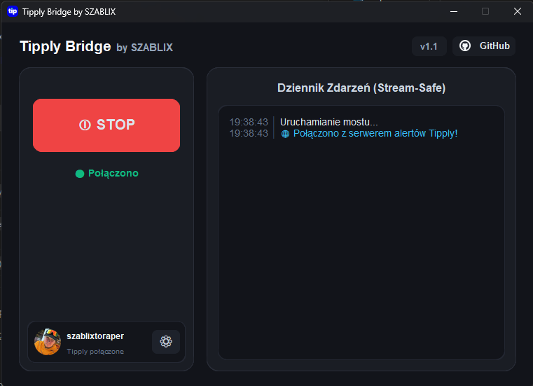

#  Tipply Bridge by SZABLIX


[](https://revolut.me/szablix)

**Tipply Bridge** to lekki, niezawodny i nowoczesny program działający w tle, który w czasie rzeczywistym przechwytuje wpłaty z platformy **Tipply** i natychmiastowo przekazuje je do **StreamElements**.

Zbudowany z myślą o streamerach, którzy chcą używać alertów StreamElements przy jednoczesnym używaniu polskiej platformy Tipply.

Pomysł na ten projekt podsunął mi przyjaciel [Oliwierdsn](https://youtube.com/@Oliwiedsn) 🫡

## ✨ Główne funkcje

* ⚡ **Zero Opóźnień (WebSockets):** Program łączy się bezpośrednio z serwerami Tipply z pominięciem przeglądarki. Powiadomienia wpadają ułamek sekundy po wysłaniu donate'a.
* 🔒 **Stream-Safe (Zero Wycieków):** Dziennik zdarzeń nie wyświetla prywatnych adresów e-mail widzów, całkowicie chroniąc dane przed wyciekiem na streamie.
* 🔍 **Automatyczne Połączenie z Tipply:** Wystarczy 1 kliknięcie, aby połączyć konto bezpośrednio z zalogowanej przeglądarki (Firefox, Chrome, Edge, Brave, Opera) – bez ręcznego kopiowania linków i szukania ciasteczek.
* 🛡️ **Mechanizm Awaryjny (Fallback):** W razie problemów po stronie Tipply, program generuje bezpieczny format adresu, dzięki czemu żaden donate nigdy nie zostanie odrzucony przez StreamElements.
* 🪶 **Ekstremalnie lekki:** Zapomnij o starych skryptach używających Selenium i Chromium. Tipply Bridge zużywa ułamek procenta procesora i pamięci RAM.
* 🎨 **Nowoczesny Interfejs (Dark Mode):** Eleganckie, gamingowe GUI zbudowane na CustomTkinter.
* 👻 **Działanie w tle (System Tray):** Kliknij "X", aby ukryć program w zasobniku obok zegarka. Będzie cicho pracował w tle, nie zaśmiecając paska zadań.
* 🛡️ **Bezpieczeństwo Tokenów:** Twoje wrażliwe tokeny (JWT, Account ID) są zapisywane w bezpiecznym folderze systemowym (%APPDATA%), a nie w zwykłym pliku tekstowym obok programu.
* 🪄 **Inteligentny Kreator Konfiguracji:** Pierwsze uruchomienie to prosty przewodnik krok po kroku.

## 📸 Zrzuty ekranu

Ekran główny:



Przekazany donate w StreamElements, zakładka **Revenue history**:


## 🚀 Jak zacząć? (Dla użytkowników Windowsa)

Nie musisz znać się na programowaniu ani instalować Pythona!
1. Przejdź do zakładki **[Releases](../../releases)** po prawej stronie.
2. Pobierz najnowszy plik `TipplyBridge_[wersja].exe` (działa również na Linuxie - użyj Wine).
3. Uruchom program i postępuj zgodnie z instrukcjami na ekranie, aby podać swoje tokeny.
4. Kliknij **START** i ciesz się połączonymi platformami!

---

## ℹ️ Ważna informacja dot. pobierania adresów e-mail (Tipply)

> [!NOTE]
> Ze względu na architekturę platformy Tipply (brak publicznego API deweloperskiego, unieważnianie/rotacja tokenów sesji przy logowaniach) oraz zabezpieczenia przeglądarek (izolacja ciasteczek, blokady plików SQLite w tle), **automatyczne wykrywanie sesji z przeglądarki u jednych użytkowników zadziała natychmiast, a u innych może nie odnaleźć aktywnego tokenu.**

### Czy to wpływa na przekazywanie donejtów?
**Absolutnie nie!** Mostek jest w 100% odporny na brak sesji. Jeśli program nie ma aktywnego tokenu sesyjnego, automatycznie przechodzi w bezpieczny **tryb widgetu** i generuje zastępczy adres e-mail (np. `widz_12345678@tipply.pl`). Wszystkie powiadomienia, kwoty, nicki, wiadomości oraz cele StreamElements działają bez zarzutu.

### Jak ręcznie uzyskać `auth_token` (dla prawdziwych maili widzów):
Jeśli zależy Ci na pobieraniu oryginalnych adresów e-mail widzów z historii Tipply, a funkcja automatycznego wykrywania nie powiodła się, możesz wkleić token ręcznie w kilka sekund:

1. Zaloguj się na swoje konto w przeglądarce na stronie [tipply.pl](https://tipply.pl/).
2. Naciśnij klawisz **F12** (lub kliknij prawym przyciskiem myszy w dowolnym miejscu i wybierz **Zbadaj / Inspect**).
3. Przejdź do zakładki z pamięcią podręczną:
   * **Google Chrome / Microsoft Edge / Brave / Opera / Vivaldi:**  
     Wybierz zakładkę **Aplikacja** (*Application*) ➔ z lewego menu rozwiń **Pliki cookie** (*Cookies*) ➔ wybierz `https://tipply.pl` (lub `https://app.tipply.pl`).
   * **Mozilla Firefox:**  
     Wybierz zakładkę **Pamięć** (*Storage*) ➔ z lewego menu rozwiń **Ciasteczka** (*Cookies*) ➔ wybierz `https://tipply.pl`.
4. Na liście ciasteczek znajdź pozycję o nazwie **`auth_token`**.
5. Kliknij dwukrotnie w pole **Wartość** (*Value*), skopiuj cały ciąg znaków i wklej go w aplikacji:
   * Podczas pierwszego uruchomienia: w **kroku 3 kreatora**, lub
   * W dowolnym momencie: klikając **⚙ Ustawienia** ➔ pole **Tipply Sesja** ➔ **ZAPISZ ZMIANY**.

> [!TIP]
> **Wskazówka:** Każde ponowne zalogowanie się na stronie Tipply w przeglądarce unieważnia poprzedni token i generuje nowy. Jeśli wylogujesz się w przeglądarce, zaktualizuj token w ustawieniach mostka.

---

## 🐧 Uruchamianie na systemie Linux


Ze względu na kaprysy nowoczesnych środowisk Linuxowych w obsłudze zasobnika systemowego (Tray), oficjalnie wspieraną i polecaną wersją jest plik `.exe`. 

Dzięki warstwie kompatybilności **Wine**, użytkownicy Linuxa mogą odpalić ten program równie łatwo co na Windowsie, bez wpisywania skomplikowanych komend!

**1. Szybka instalacja Wine:**
Jeśli jeszcze nie masz Wine, otwórz na moment terminal i wklej jedną z poniższych komend, zależnie od Twojego systemu:

* **Arch Linux / CachyOS / Manjaro:** `sudo pacman -S wine`
* **Debian / Ubuntu / Linux Mint:** `sudo apt install wine`
* **Fedora:** `sudo dnf install wine`

**2. Uruchomienie programu (Prościej się nie da!):**
1. Pobierz gotowy plik `.exe` z zakładki **Releases**.
2. Otwórz swój folder z Pobraniami.
3. Kliknij na plik prawym przyciskiem myszy i wybierz **"Otwórz za pomocą: Wine"** (lub na niektórych systemach po prostu **kliknij go dwa razy**!).

Gotowe! Program otworzy się normalnie, a ikonka będzie bez problemu chować się do paska zadań.

## 🛠️ Samodzielna kompilacja (Dla deweloperów)

Jeśli wolisz uruchomić aplikację bezpośrednio ze źródeł lub skompilować własny plik `.exe`:

### 1. Wymagania
* Python 3.10 lub 3.11 (zalecany oficjalny instalator ze strony [python.org](https://www.python.org/) z zaznaczoną obsługą `tcl/tk and IDLE`)
* Narzędzie `git`

### 2. Klonowanie repozytorium i instalacja zależności
```bash
git clone https://github.com/KrolestwoSZABLIXa/tipply-bridge.git
cd tipply-bridge

# Utworzenie i aktywacja środowiska wirtualnego:
python -m venv .venv
.venv\Scripts\activate

# Instalacja wymaganych pakietów:
pip install --upgrade pip
pip install -r requirements.txt pyinstaller
```

### 3. Uruchomienie programu
```bash
python app.py
```

### 4. Kompilacja do pliku wykonywalnego (.exe)
Aby zbudować samodzielny, jedno-plikowy program dla Windowsa ze wszystkimi zasobami (czcionka DM Sans, logotyp, ikona):
```bash
pyinstaller --noconfirm --clean --onefile --windowed --icon=logo.ico --add-data "logo.ico;." --add-data "assets;assets" --collect-all customtkinter --hidden-import=tipply_auth --name=TipplyBridge_Windows app.py
```
Skompilowany plik pojawi się w katalogu `dist/TipplyBridge_Windows.exe`.


